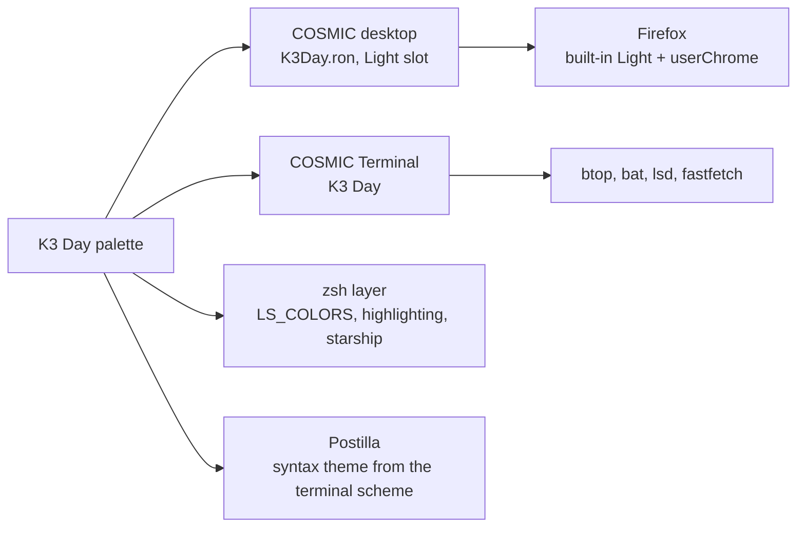

# K3 Day

> Pearl, steel and charcoal, with terracotta kept for what is wrong. A light rice with no loud colour.

Pop!_OS 24.04 on the COSMIC desktop, one palette carried through the whole
machine: desktop, terminal, shell, editor, browser. This note is the rice
describing itself, written in Markdown and rendered by **Postilla**.

## Palette

Every text colour is checked against the window background  `#E5E6E6`.

| Role | Hex | Contrast on background |
|------|-----|------------------------|
| Text |  `#1A1B1B` | 13.8:1 |
| Steel, accent |  `#586065` | 5.1:1 |
| Orange, warning |  `#A04412` | 5.0:1 |
| Terracotta, error |  `#B03316` | 5.0:1 |
| Mist, success |  `#5E5E5E` | 5.2:1 |
| Khaki, symlinks |  `#666052` | 5.0:1 |
| Pewter, directories |  `#5B5D5D` | 5.3:1 |
| Muted |  `#616161` | 5.0:1 |

Containers sit one step away from the background at  `#F0F2F2`, which is
what frosted glass blurs into.

## Where the colours go



## Setup, in order

- [x] Import `cosmic/K3Day.ron` into Appearance, **Dark** slot
- [x] Import `cosmic-term/K3Day-term.ron`, pick **K3 Day** for the profile
- [x] `./icons/install.sh` for the **Cosmic-K3Day** icons, `./cosmic/install.sh` for fonts and the terminal look
- [x] `./zsh/install.sh`, `./lsd/install.sh`, `./fastfetch/install.sh`
- [x] Cursor: Oxygen-K3Day-Steel
- [x] Wallpaper: `backgrounds/k3day-stardust.jpg`
- [ ] Screenshot for the README

## The baseline every rice shares

```ron
corner_radii: (
    radius_xs: (2.0, 2.0, 2.0, 2.0),   // squared corners
    radius_xl: (2.0, 2.0, 2.0, 2.0),
),
frosted: Low,
frosted_windows: true,
frosted_panel: true,
frosted_applets: true,
frosted_maximized_apps: false,
gaps: (0, 7),
active_hint: 1,
```

Contrast is the WCAG ratio[^1], where $L$ is relative luminance:

```typst
$ (L_1 + 0.05) / (L_2 + 0.05) >= 4.5 $
```

---

*Rendered in Postilla, a Markdown notes app for COSMIC. The window is painted
with this rice's terminal scheme, imported as a syntax theme.*

[^1]: Web Content Accessibility Guidelines, success criterion 1.4.3. Normal text wants 4.5:1, large text 3:1.
